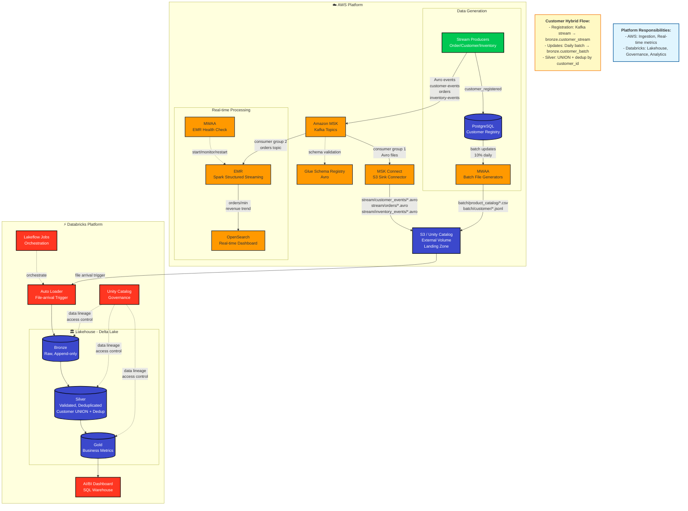

# E-commerce Data Pipeline Architecture

## Converting to PDF

This document contains a Mermaid diagram that can be converted to PDF using several methods:

### Option 1: Using mermaid-cli (Recommended)

```bash
# Install mermaid-cli globally
npm install -g @mermaid-js/mermaid-cli

# Convert to PDF
mmdc -i docs/architecture_diagram.md -o docs/architecture_diagram.pdf

# Or convert to PNG
mmdc -i docs/architecture_diagram.md -o docs/architecture_diagram.png -w 2400
```

### Option 2: Using VS Code

1. Install "Markdown Preview Mermaid Support" extension
2. Open this file in VS Code
3. Use Preview mode (Cmd+Shift+V or Ctrl+Shift+V)
4. Right-click on the preview → "Print" → "Save as PDF"

### Option 3: Using Online Tools

1. Copy the Mermaid code block (lines starting with ` ```mermaid `)
2. Visit https://mermaid.live or https://kroki.io
3. Paste the code and export as PDF/PNG/SVG

### Option 4: Using GitHub

1. Push this file to GitHub
2. View the file on GitHub (renders Mermaid automatically)
3. Use browser "Print to PDF" on the rendered page

## Architecture Diagram



## Key Components

### AWS Platform

| Component | Purpose | Technology |
|-----------|---------|------------|
| **Stream Producers** | Generate order, customer, inventory events | Python, confluent-kafka, Faker |
| **Amazon MSK** | Message broker for real-time events | Kafka (3 topics: customer-events, orders, inventory-events) |
| **Glue Schema Registry** | Schema validation for Avro messages | AWS Glue |
| **MSK Connect** | Land Avro events to S3 | S3 Sink Connector |
| **EMR Streaming Job** | Real-time metrics computation | Spark Structured Streaming |
| **OpenSearch** | Real-time dashboard (orders/min, revenue) | OpenSearch + Dashboards |
| **MWAA** | Batch file generation + EMR health check | Apache Airflow |
| **PostgreSQL** | Customer registry (source of truth) | RDS (AWS) / Docker (local) |
| **S3 / UC External Volume** | Landing zone for all data | S3, exposed as Unity Catalog volume |

### Databricks Platform

| Component | Purpose | Technology |
|-----------|---------|------------|
| **Auto Loader** | Incremental file ingestion | Databricks Auto Loader |
| **Bronze Layer** | Raw data, append-only | Delta Lake |
| **Silver Layer** | Validated, deduplicated, conformed | Delta Lake + DQ rules |
| **Gold Layer** | Business metrics and aggregations | Delta Lake |
| **Unity Catalog** | Data governance, lineage, access control | Unity Catalog |
| **Lakeflow Jobs** | Orchestration with file-arrival triggers | Databricks Workflows |
| **AI/BI Dashboard** | Analytics dashboard | Databricks SQL Warehouse |

## Data Flows

### 1. Real-time Stream Path (AWS Only)
```
Producers → MSK → EMR Streaming → OpenSearch Dashboard
```
- **Purpose:** Real-time metrics (orders/min, revenue)
- **Latency:** Seconds
- **Does NOT write to lakehouse**

### 2. Stream Landing Path (AWS → Databricks)
```
Producers → MSK → MSK Connect → S3 (Avro) → Auto Loader → Bronze
```
- **Purpose:** Replay-able source of truth
- **Format:** Avro files
- **Topics:** customer-events, orders, inventory-events

### 3. Batch Landing Path (AWS → Databricks)
```
MWAA (Faker) → S3 (CSV/JSONL) → Auto Loader → Bronze
```
- **Purpose:** Master data (catalog, customer updates)
- **Format:** CSV (catalog), JSONL (customer)
- **Frequency:** Daily

### 4. Customer Hybrid Flow (AWS → Databricks)
```
Registration: Producer → Kafka → MSK Connect → bronze.customer_stream
Updates: PostgreSQL → MWAA → S3 → bronze.customer_batch
Silver: UNION(customer_stream, customer_batch) → dedup by customer_id
```

### 5. Lakehouse Transformation (Databricks)
```
Bronze (raw) → Silver (validated, deduplicated) → Gold (metrics) → Dashboard
```
- **Bronze:** Append-only, raw events
- **Silver:** DQ validation, deduplication, PII masking, customer UNION
- **Gold:** Derived metrics (demand forecast, stockout risk)

## Topics and Events

| Kafka Topic | Key | Event Types | Volume |
|-------------|-----|-------------|--------|
| `customer-events` | customer_id | customer_registered | ~10K/day |
| `orders` | order_id | order_created, order_status_changed | 1M/day |
| `inventory-events` | product_id + warehouse_id | reserved, released, restocked | 100K/day |

## Landing Layout

```
/Volumes/<catalog>/landing/raw/
  stream/
    customer_events/      # Avro from MSK Connect
    orders/               # Avro from MSK Connect
    inventory_events/     # Avro from MSK Connect
  batch/
    product_catalog/dt=YYYY-MM-DD/*.csv
    customer/dt=YYYY-MM-DD/*.jsonl
```

## Dashboards

| Dashboard | Platform | Source | Metrics |
|-----------|----------|--------|---------|
| **Real-time** | OpenSearch | EMR streaming job | Orders per minute, revenue trend |
| **Analytics** | Databricks AI/BI | Gold tables | Daily sales, product ranking, customer segments, stockout risk |

## Cost Optimization Strategy

**Development Phase:**
- Local Docker: Airflow, Kafka, PostgreSQL
- Minimal AWS usage (S3 only, access via `aws_default` connection)

**Demo Phase (1 day max):**
- Provision: MWAA (smallest), MSK, MSK Connect, EMR, OpenSearch, RDS (db.t3.micro)
- Run full pipeline end-to-end
- Collect evidence (screenshots, logs, metrics)
- **Teardown everything** after demo

**Infrastructure as Code:**
- Terraform for one-command provision/teardown
- No hardcoded credentials or account IDs
